# Изучение работы кешей и выявление наиболее эффективного.
Кеш - это временное хранилище для данных, которые с наибольшей вероятностью могут быть повторно запрошены. Загрузка данных из кеша уровнем выше осуществляется быстрее, чем из хранилища с исходными данными или из кеша уровнем ниже, но объём кешей ограничен.

## Обзор алгоритмов кеширования
1) LFU - Least Frequently Used
2) ARC - Adaptive replacement cache
3) LIRS - Low Inter-reference Recency Set
4) 2Q - Two-Queue cache replacement algorithm
5) Perfect

## LFU - Least Frequently Used
LFU - алгоритм, который подсчитывает частоту использования каждого элемента и удаляет те, к которым обращаются реже всего.
Какой путь проходит запрос:
1) если элемент есть в кеше (т.е. в хеш-таблице), то мы увеличиваем на 1 число этого запроса и перемещаем (если нужно) ближе к началу очереди запросов (двигаем элемент вперед до тех пор, пока не наткнемся на элемент, у которого частота обращения больше).
2) если элемента нет в кеше, то количество его появлений становится 1 и он помещается в очередь.

## ARC - Adaptive replacement cache

Алгоритм использует 4 очереди:
T1 - элементы, запрошенные недавно 1 раз, данные хранятся в памяти, 
T2 - элементы запрошенные недавно больше одного раза, данные в памяти, 
B1 - вытесненные из T1, без страницы в памяти, 
B2 - вытесненные из T2, без страницы в памяти
 
Какой путь проходит запрос:
1) если элемент в B1, то мы переносим его в начало T2 (при необх сдвигая последний T2 в B2 (при необх удаляя последний B2)) 
2) если ф в B2, то в T2 аналогично (или если T1 сильно разлослась, то просто добавляется место для T2)
3) если нет нигде, то в T1 и тоже там крайние элементы сдвигаем
4) если элемент в T1/T2, то перенос в начало T1/T2

Причем размеры очередей T1, T2 могут меняться: если запрошенный элемент имеет статус B1, то увеличивается размер T1 (часто запрашиваются неповторяющиеся данные), если B2 - то соответственно увеличивается T2 (часто запрашиваются одни и те же данные), однако суммарный размер T1 и T2 ограничен размером кеша.

## LIRS - Low Inter-reference Recency Set

IRR(x) - количество уникальных обращений к другим страницам между обращениями к x
R(x) - количество обращений к x
LIR (Low Inter-reference Recency) - «горячие» и стабильно востребованные элементы, которые редко вытесняются из кеша
HIR (High Inter-reference Recency) - «холодные» или редко используемые элементы, которые подлежат замене первыми
(в моей реальзации есть hir_res - данные в памяти и hir_non_res - без страниц в памяти)
В этом алгоритме кеширования используется 2 очереди: Q и S. S - хранит историю запрашиваемых страниц, Q - хранит res_hir.
Для lir выделяется 95% места, для hir соответственно 5%
Какой путь проходит запрос:
1) если такого элемента в хеш-таблице еще нет, то он помещается в S (на вершину) и в Q (если надо - вытесняя самый старый hir в Q), элемент получает статус lir, если максимальное число lir не достигнуто, иначе - hir
2) если элемент в хеш-таблице помечен как lir, то в S он перемещается на вершину (обновляя R, IRR), если на дне теперь hir блоки, то их удаляем чтоб хеш-таблица не разрасталась бесконечно
3) если элемент в хеш-таблице помечен как hir:
     -он в S: он перемещается на вершину S, R и IRR обновляются, самый старый lir->hir и отправляется в начало Q, опять очистка старых hir в S
     -блока нет в S: перемещается в начало S и Q, остается hir

## 2Q - Two-Queue cache replacement algorithm

IN — очередь, в которую помещаются новые элементы.
OUT — очередь, в которую перемещаются элементы, вытесненные из IN.
MAIN - очередь для элементов, запрошенных из OUT.
Распределение размера кеша: 25% под IN, 50% под OUT => 25% под MAIN.

Какой путь проходит запрос:
1) если элемента в хеш-таблице нет: он помещается в очередь IN (в ее начало) 
   если кеш заполнен, освобождаем место (удаляем с конца IN и переносим удаленное в OUT, либо удаляем с конца MAIN).
2) если элемент имеет статус IN: он уже в памяти, при повторном запросе остается в IN (переносится на вершину IN).
3) если элемент имеет статус MAIN: он переносится на вершину MAIN.
4) если элемент имеет статус OUT: значит к нему обратились повторно, но он был вытеснен.
    Он получает статус MAIN, загружается в память и помещается на вершину MAIN.
Получается, в IN лежат элементы, которые либо вызваны в первый раз, либо которые вызываются постоянно, их ключи есть в хеш-таблице, в MAIN лежат элементы, данные которых запрашивались не так давно, их ключи тоже лежат в хеш-таблице. В OUT хранятся только ключи, для доступа к странице нужно загрузить данные в память.

## Perfect 
Теоретически идеальный алгоритм (Алгоритм Белади) служит верхней границей эффективности. Он знает будущее и при заполнении памяти вытесняет тот элемент, который потребуется позже всего или не потребуется больше вообще.

Какой путь проходит запрос:
1) если элемент уже есть в кеше, мы увеличиваем счетчик попаданий, удаляем текущий шаг из его истории и обновляем его приоритет в очереди будущего.
2) если элемента нет в кеше:
-если кеш заполнен, алгоритм находит элемент, у которого индекс следующего запроса максимален (или равен бесконечности INF, если он больше не нужен), и удаляет его из хэш-таблицы и множества.
-из истории нового элемента удаляется текущий шаг, вычисляется индекс его следующего появления, и он добавляется в кеш.
# Измерение эффективности кешей

Для оценки эффективности кешей измерялись следующие параметры: 
1) количество попаданий
2) время работы

Для того, чтобы сравнить кеши, нужно пропустить через них одни и те же запросы. 
В реальных системах (CDN, СУБД, веб-серверы) запросы к данным распределены неравномерно: небольшая группа элементов запрашивается колоссальное количество раз, в то время как основная масса элементов запрашивается редко. Генератор воспроизводит это поведение, позволяя оценить количество попаданий в кеш в условиях высокой концентрации запросов. Для генерации одинаковых запросов для всех кешей использовался алгоритм Ципфа.
## закон Ципфа
Если перечислить слова языка в порядке убывания частоты их использования, то частота n-го слова будет примерно обратно пропорциональна его порядковому номеру (рангу). То есть первое по популярности слово встречается в два раза чаще второго и в три раза чаще третьего.

Частота появления элемента с рангом k описывается формулой:

\[P(k) = \frac{1}{k^\alpha \cdot H_{N, \alpha}}\]
В моих тестах использовался коэффициент \alpha = 0.75

## Методика измерения времени
```
for (int i = 0; i < MAX_REQUESTS; i += 5000)
  {
    clock_t start = 0, fin = 0;

    std::vector<long long> prms_vec = generate_zipf_vector(cache_size, i);
    start = clock();
    long long hits = ZipfTest(cache_size, i, prms_vec);

    fin = clock();
    total_time += (double)(fin - start) / CLOCKS_PER_SEC;

    printf("cache size = %d, total_requests = %d, hits = %lld\n", cache_size, i, hits);
    fprintf(file_rt, "%d,%lld\n", i, hits);
  }
```
clock() - возвращает процессорное время, затраченное программой. Может не совпадать с реально прошедшим временем, но мы сравниваем результаты между собой, а не с каким-то эталонным временем, поэтому этот вариант нам подходит.

## Измерения
Сначала для измерений я выбрала размер кеша, равный 5000, а количество запросов от 0 до 500 тысяч с шагом 5 тысяч. Данные были получены для пяти кешей: LFU, ARC, 2Q, LIRS и идеального кеша для сравнения. Все измерения проводились для одного набора данных, опять же для того, чтобы сравнивать друг с другом.
<div align="center">
  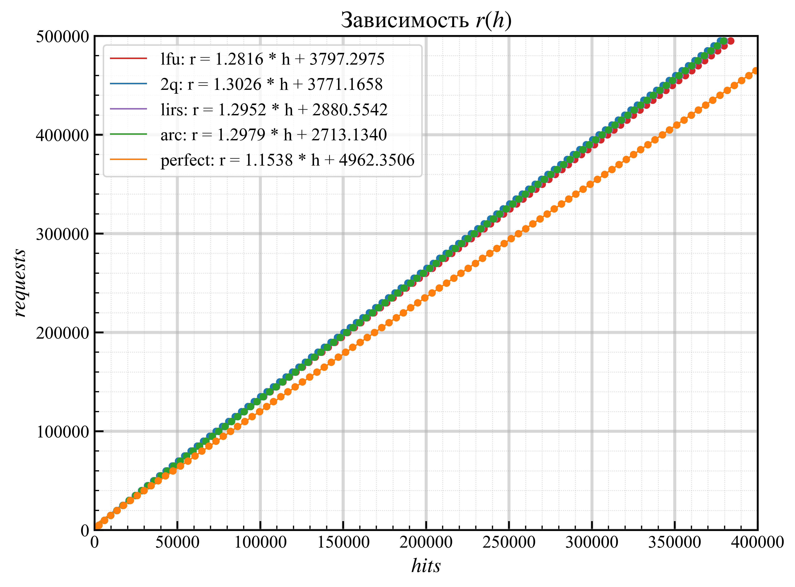
  <br>
  <sub>max(requests) = 5 $\cdot 10^{5}$, cache_size = 5000</sub>
</div>

Прямые построены по МНК. По горизонтальной оси количество попаданий в кеш, а по вертикальной - количество запросов. Так, чем меньше угол наклона прямой, тем больше попаданий для заданного количества запросов. Поэтому вполне логично, что идеальный кеш имеет график с наименьшим угловым коэффициентом.
Рассмотрим фрагменты графика ближе:

<div align="center">
  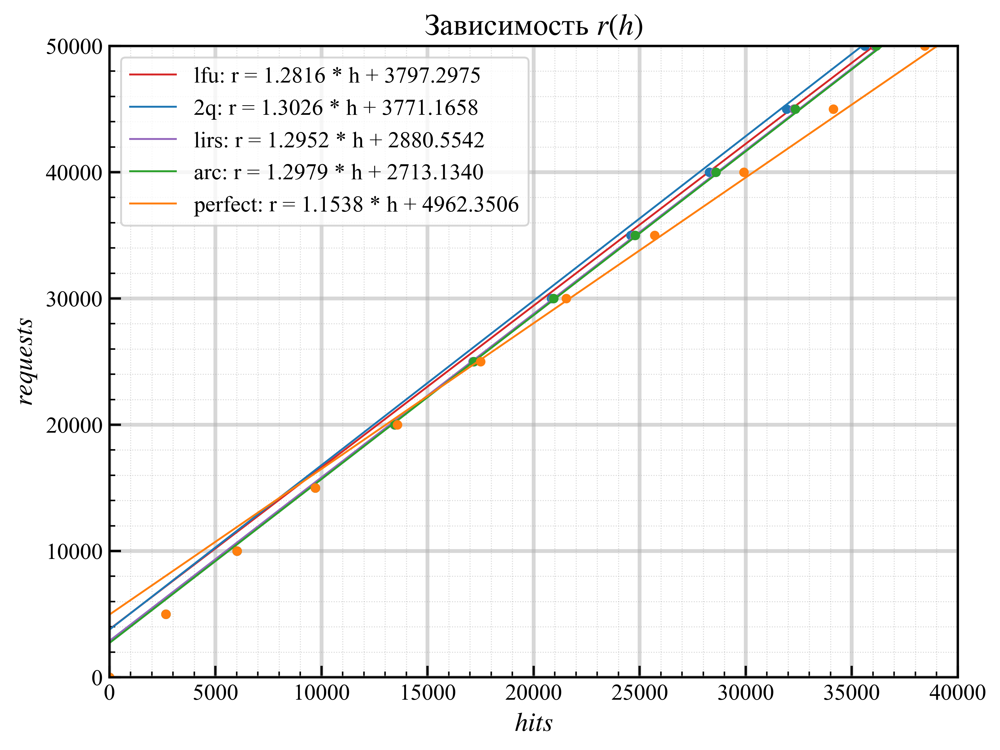
  <br>
  <sub>тот же график, но ближе к началу координат</sub>
</div>

Сложно не заметить, что при небольших количествах запросов (до 15 тысяч) разницы в количестве попаданий не видно, но при увеличении количества запросов идеальный кеш показывает себя эффективнее.

<div align="center">
  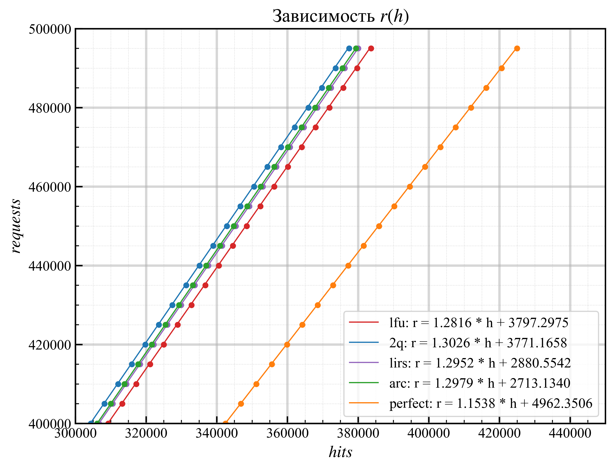
  <br>
  <sub>тот же график, но ближе к максимальным значениям измерений</sub>
</div>
Собственно, угловые коэффициенты уже показали, как себя повели разные алгоритмы кеширования, но но теперь это еще и хорошо видно на графике.

Время измерений:
кеш                             | с
--------------------------------|-------
2Q                              | 19.6188
ARC                             | 19.9384
Perfect                         | 23.0314
LIRS                            | 27.3668
LFU                             | 741.275

Несмотря на то, что 2Q показал наименьшее количество попаданий, он завершил работу раньше остальных алгоритмов, но в целом, времена первых четырех кешей близки друг к другу и от запуска к запуску время работы может немного меняться. LFU прям жестко проигрывает в этой гонке. Скорее всего это связано с тем, что при каждом новом запросе LFU, обновляя счетчик попаданий, ищет новое место для элемента, соответствующее его частоте вызовов, в то время как другие алгоритмы просто перебрасывают элемент в начало очереди при запросе. 

Уменьшим размер кеша и посмотрим, к чему это приведет:
<div align="center">
  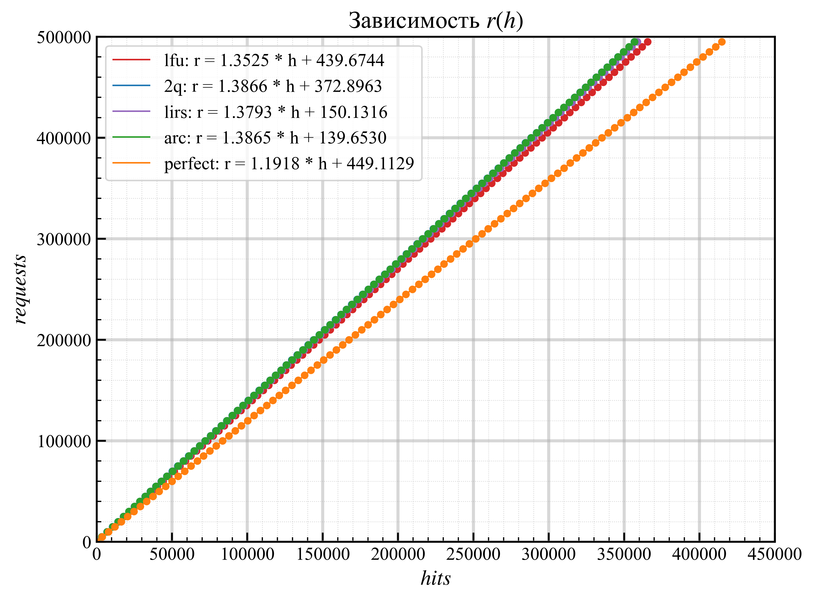
  <br>
  <sub>max(requests) = 5 $\cdot 10^{5}$, cache_size = 500</sub>
</div>

Угловые коэффициенты выросли по сравнению с предыдущими. Это логично, размер кеша уменьшился, а значит, мы можем там хранить меньше элементов, отсюда и меньше попаданий.

<div align="center">
  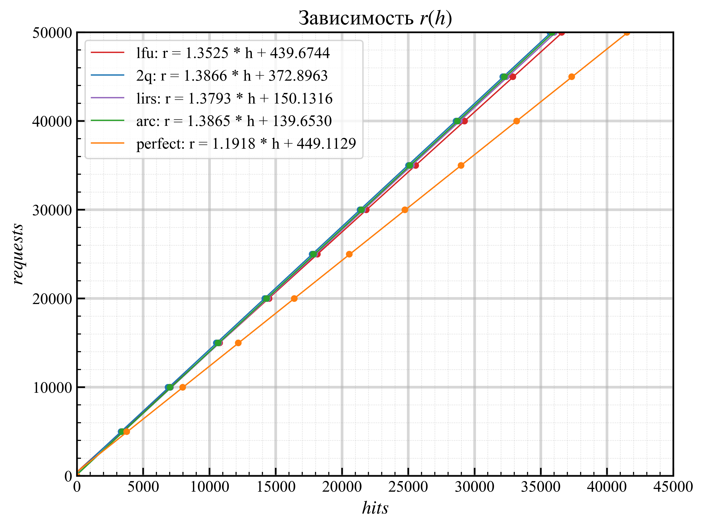
  <br>
  <sub>тот же график, но ближе к началу координат</sub>
</div>
Количество запросов все так же меняется с шагом 5000, поэтому уже с начала измерений можем наблюдать превосходство идеального кеширования.

<div align="center">
  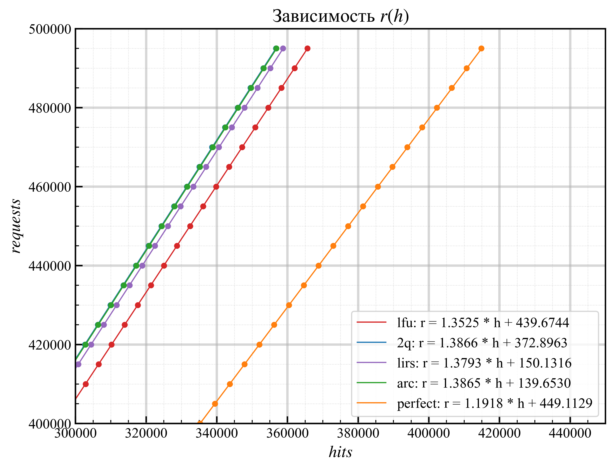
  <br>
  <sub>тот же график, но ближе к максимальным значениям измерений</sub>
</div>
Снова за идеальным кешированием по количеству попаданий стоит LFU - самый простой в реализации!

Время измерений:
кеш                             | с
--------------------------------|-------
2Q                              | 9.90065
ARC                             | 10.7484
LIRS                            | 13.4116
Perfect                         | 20.2767
LFU                             | 44.9962

Во времени снова более сложные алгоритмы выигрывают. Но тут уже LFU вполне реально дождаться, это не может не радовать.

Теперь поэкспериментируем с двухуровневым кешированием. Размер кеша оставляем 500.
<div align="center">
  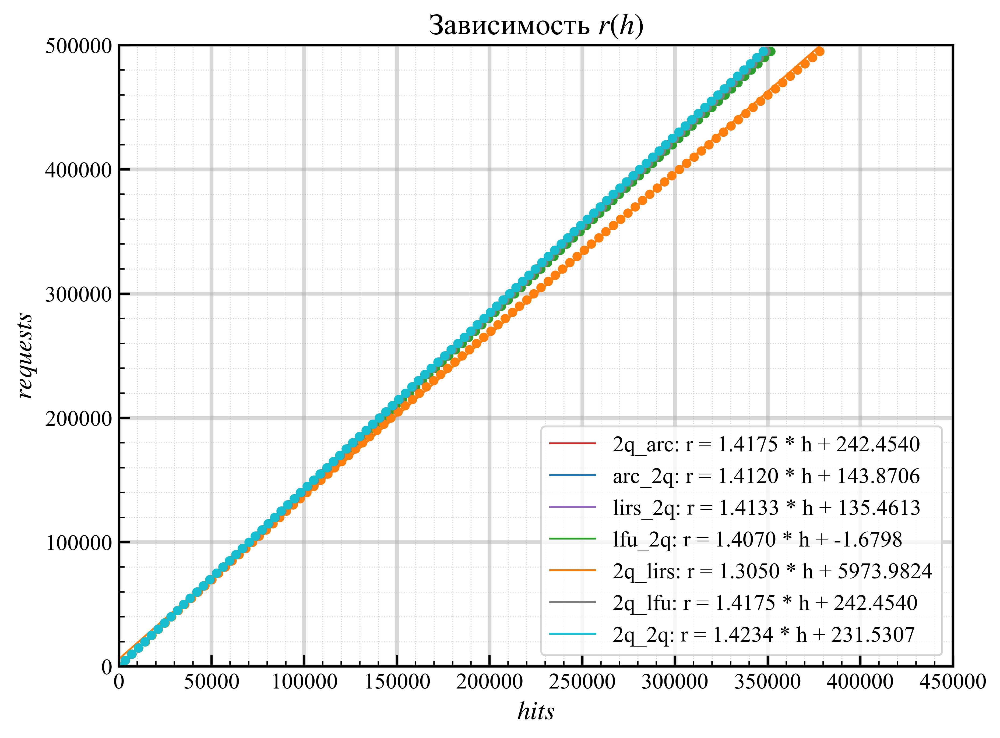
  <br>
  <sub>max(requests) = 5 $\cdot 10^{5}$, cache_size = 500</sub>
</div>
Количество попаданий уменьшилось везде кроме одной комбинации!!
<div align="center">
  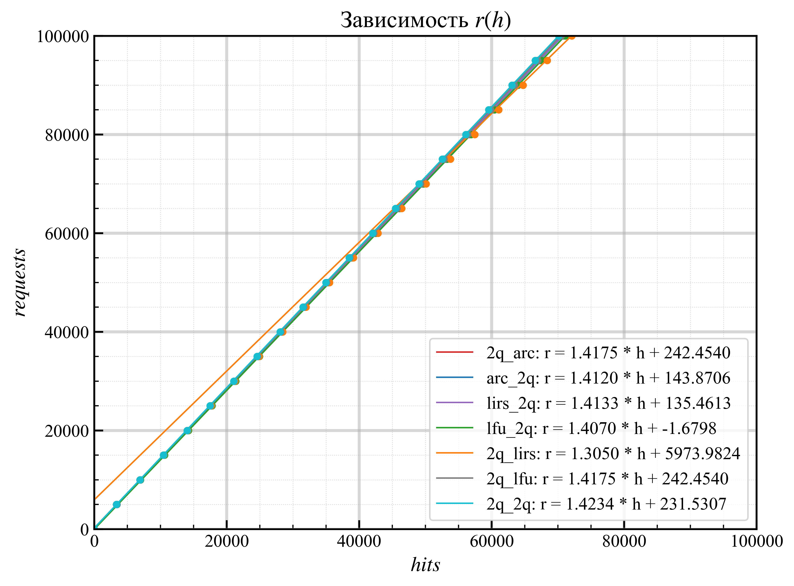
  <br>
  <sub>тот же график, но ближе к началу координат</sub>
</div>
Снова количество хитов начинает отличаться с увеличением запросов.

<div align="center">
  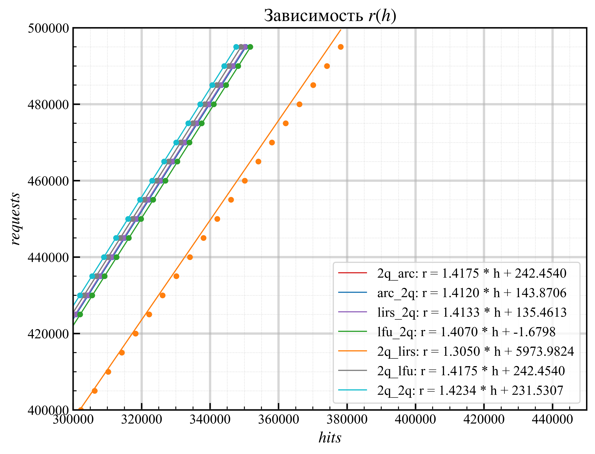
  <br>
  <sub>тот же график, но ближе к максимальным значениям измерений</sub>
</div>

Довольно неожиданный результат - можно подобрать комбинацию кешей так, чтобы 2 уровня давали попаданий больше, чем 1 уровень.

Время измерений:
кеш                             | с
--------------------------------|-------
2q + 2q                         | 33.318
2q + lirs                       | 36.9195
lirs + 2q                       | 37.3968
2q + arc                        | 38.0977
arc + 2q                        | 38.3425
lfu + 2q                        | 65.9442
2q + lfu                        | 130.992

Распределение времени довольно логично - кеши выстроились по скорости так же, как и в случае одного уровня. 
<div align="center">
  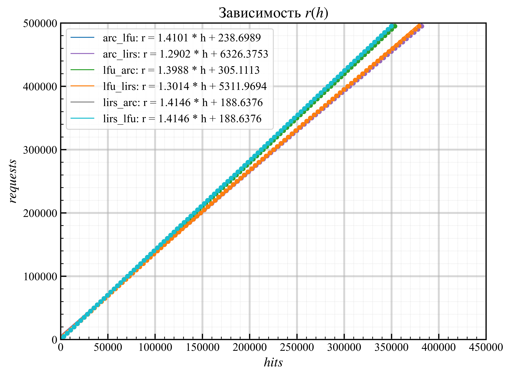
  <br>
  <sub>max(requests) = 5 $\cdot 10^{5}$, cache_size = 500</sub>
</div>
<div align="center">
  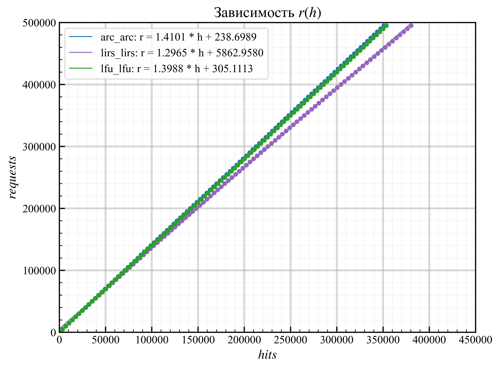
  <br>
  <sub>max(requests) = 5 $\cdot 10^{5}$, cache_size = 500</sub>
</div>

Все комбинации с LIRS на втором уровне показали превосходные результаты, обогнав в количестве хитов одноуровневый LIRS. Это можно объяснить тем, что первый уровень кеша отсек однократные запросы и на втором уровне LIRS получал проверенные данные, которые дольше держались на втором уровне, а следовательно - частота обращений к элементам теперь измерялась дольше, просто потому что однократные запросы не вытесняли недавно появившиеся в кеше частые. 

## Заключение
Алгоритмы ARC, LIRS, 2Q показали небольшое относительно LFU время работы, ARC и 2Q оказались быстрее идеального кеширования. Среди одноуровневых кешей наиболее близким по эффективности к идеальному оказался LFU, а среди двухуровневых кешей эффективнее всего себя показала комбинация ARC + LIRS. 